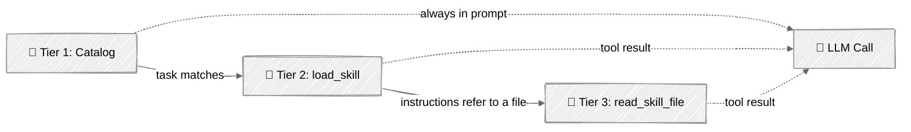

<!-- ---
title: "Skills"
description: "Inject specialized capabilities on demand with filesystem-based Agent Skills and progressive disclosure"
icon: "sparkles"
--- -->

# Skills

Every instruction you add to a system prompt is paid for on every request, whether or not the task needs it. Skills flip that: expertise lives in folders on disk, a one-line catalog stays in the prompt, and the agent pulls in the rest only when a task calls for it.

It is the first control surface in this module, and the only change to the [bare agent loop](../../01-foundations/05-agent-loop/) is two new tools.

## 🎯 What You'll Learn

- Structure a `SKILL.md` with YAML front-matter (name, description) and a Markdown body
- Implement three-tier progressive disclosure: catalog → load skill → read bundled files
- Give the agent `load_skill` and file-reading tools to discover capabilities at runtime
- Guard skill loading against path traversal and keep the base prompt lean

## 📦 Available Examples

| Provider | File | Description |
| -------- | ---- | ----------- |
|  | [01_skills_agent_anthropic.py](01_skills_agent_anthropic.py) | Skill library plus an agent that loads skills on demand |
| | [skills/](skills/) | Three sample skills: `release-notes`, `sql-review`, `incident-postmortem` |

## 🚀 Quick Start

> **Prerequisites:** Python 3.11+, API keys, and uv. See [SETUP.md](../../SETUP.md) for full setup instructions.

```bash
uv run --directory 05-loop-engineering/01-skills python 01_skills_agent_anthropic.py
```

Or use the [Code Runner](https://marketplace.visualstudio.com/items?itemName=formulahendry.code-runner) VS Code extension to run the currently open script with a single click.

The catalog, size comparison, and path guard demo all run without an API key. The live agent starts when `ANTHROPIC_API_KEY` is set. Try all three examples: the third needs no skill, so the panel after it should report that nothing was loaded.

## 🔑 Key Concepts

### 1. A Skill Is Just a Folder

```
skills/
└── release-notes/
    ├── SKILL.md                # Front-matter + instructions
    ├── references/
    │   └── style-guide.md      # Loaded only if the instructions call for it
    └── assets/
        └── template.md
```

`SKILL.md` has two audiences. The front-matter is for the *catalog*, so the description must say when to use the skill as well as what it does. The body is for the *agent that has already decided to use it*.

```markdown
---
name: release-notes
description: Turn a list of code changes into customer-facing release notes. Use when the user asks for release notes, a changelog entry, or a "what's new" summary.
---

# Release Notes

1. Read `references/style-guide.md` for voice and wording rules.
...
```

### 2. Three-Tier Progressive Disclosure



| Tier | What loads | When | Cost |
|------|-----------|------|------|
| 1. Catalog | `name` and `description` | Every request | A line per skill |
| 2. Instructions | `SKILL.md` body and a file index | When the task matches | Only for this task |
| 3. Bundled files | References, templates | When the instructions need them | Only for this task |

The script prints the difference at startup:

```python
def catalog(self) -> str:
    """Tier 1: one line per skill, cheap enough to keep in every request."""
    return "\n".join(f"- {s.name}: {s.description}" for s in self.skills.values())
```

Install fifty skills and tier 1 grows by fifty lines. Inline them instead and every request carries all of them.

### 3. Skills Arrive as Tool Results, Not Prompt Edits

It's tempting to append a loaded skill to the system prompt. Don't: the system prompt is part of the prefix that prompt caching and thinking-block validation depend on, so changing it mid-session throws away your cache and invalidates earlier thinking.

```python
# Frozen for the whole session
self.system_prompt = BASE_SYSTEM_PROMPT.format(catalog=library.catalog())
```

`load_skill` returns the instructions as an ordinary tool result. The conversation stays append-only, and the skill leaves context the moment the task ends.

### 4. Treat Paths as Hostile

The model chooses the arguments to `read_skill_file`, and a prompt-injected document can influence what it chooses. Two rules keep it inside the skill folder:

```python
def read_file(self, name: str, relative_path: str) -> str:
    root = self._get(name).directory.resolve()     # Names are looked up, never joined as paths
    target = (root / relative_path).resolve()      # Collapses ../ and follows symlinks
    if not target.is_relative_to(root):
        raise SkillError(f"path {relative_path!r} escapes the skill folder")
```

Check where the path actually *lands* rather than searching the string for `..`. String checks miss absolute paths (`root / "/etc/passwd"` is just `/etc/passwd`) and symlinks.

Rejections go back to the model as `is_error` tool results, so the agent can correct itself and the session doesn't crash.

## ⚠️ Important Considerations

- **Descriptions do the routing** — a vague description means the skill never gets loaded. Test by running tasks and checking the "What this task loaded" panel.
- **A skill is executable trust** — its instructions steer the agent as strongly as your prompt does. Only install skills you've read, and treat third-party skills like third-party code.
- **These sample skills don't run code** — real skills often bundle scripts. Executing those safely needs the [sandbox](../03-sandboxing/).
- **Loaded skills still fill the context window** — long sessions need [compaction](../06-context-compaction/).
- **Hosted alternative** — Anthropic's API can also run packaged Agent Skills in its own code-execution container. This tutorial builds the mechanism by hand so you can see how it works.

## 🔗 Resources

- [Introducing Agent Skills — Anthropic](https://www.anthropic.com/news/skills) — The announcement and motivating use cases
- [Equipping Agents for the Real World with Agent Skills — Anthropic](https://www.anthropic.com/engineering/equipping-agents-for-the-real-world-with-agent-skills) — Design rationale behind progressive disclosure
- [Agent Skills Specification](https://agentskills.io/specification) — The `SKILL.md` format, naming rules, and folder conventions
- [Anthropic Skills Repository](https://github.com/anthropics/skills) — Real-world example skills to read and adapt

## 👉 Next Steps

Continue to **[Hooks & Lifecycle](../02-hooks-lifecycle/)** to control what the agent does, now that you can control what it knows.

**Experiments to try:**

- Write a skill of your own and check that the agent finds it from the description alone
- Weaken the `release-notes` description and watch the agent stop loading it
- Add a fourth tier: a `run_skill_script` tool, then read the sandboxing tutorial before trusting it
