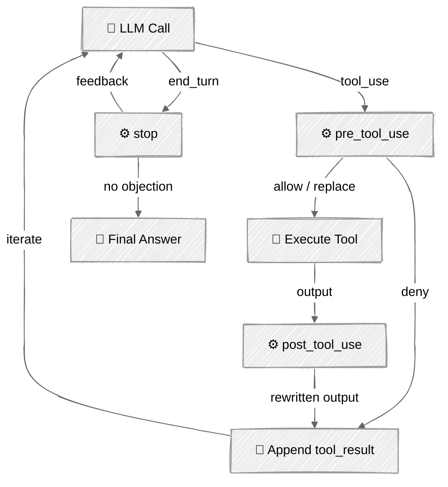

<!-- ---
title: "Hooks & Lifecycle"
description: "Intercept the agent loop at pre/post tool-use and stop events with pluggable callbacks"
icon: "git-branch"
--- -->

# Hooks & Lifecycle

So far, adding a guardrail has meant editing the agent loop. Add logging, approvals, redaction, and a "did you actually test it?" check that way and the loop turns into a pile of `if` statements. Hooks fix this: the loop exposes named lifecycle events, and everything else plugs in from the outside.

This is the extensibility surface every later tutorial plugs into.

## 🎯 What You'll Learn

- Design a hook registry mapping lifecycle events to callables
- Handle `pre_tool_use`, `post_tool_use`, and `stop` events
- Return allow / deny / replace decisions from a pre-tool-use hook
- Re-express blocked-command guardrails as a built-in hook

## 📦 Available Examples

| Provider | File | Description |
| -------- | ---- | ----------- |
|  | [01_hooks_agent_anthropic.py](01_hooks_agent_anthropic.py) | Hook registry, built-in guardrails, a scripted dry run, and a live agent |

## 🚀 Quick Start

> **Prerequisites:** Python 3.11+, API keys, and uv. See [SETUP.md](../../SETUP.md) for full setup instructions.

```bash
uv run --directory 05-loop-engineering/02-hooks-lifecycle python 01_hooks_agent_anthropic.py
```

Or use the [Code Runner](https://marketplace.visualstudio.com/items?itemName=formulahendry.code-runner) VS Code extension to run the currently open script with a single click.

The scripted dry run needs no API key: it fires tool calls straight through the hooks and prints each decision. The live agent starts when `ANTHROPIC_API_KEY` is set, and the second and third examples are written to trip the guardrails.

## 🔑 Key Concepts

### 1. The Loop Has Three Seams



| Event | Can it change the outcome? | Typical uses |
|-------|---------------------------|--------------|
| `pre_tool_use` | Allow, deny, or replace the arguments | Guardrails, approvals, path rewriting |
| `post_tool_use` | Rewrite the result | Secret redaction, truncation, audit logs |
| `stop` | Send the agent back to work | "Run the tests first", output validation |

### 2. A Registry in About 60 Lines

The registry maps events to callables and needs no dependencies. A matcher limits a hook to one tool:

```python
hooks = HookRegistry()

@hooks.on(HookEvent.PRE_TOOL_USE, tool="bash")
def block_dangerous_commands(_tool, tool_input):
    for pattern in BLOCKED_COMMAND_PATTERNS:
        if re.search(pattern, tool_input.get("command", "")):
            return deny(f"Blocked: command matches dangerous pattern {pattern!r}")
    return None  # No objection
```

This is the blocked-commands guardrail from the earlier tutorials, except that now it's a hook. You can add it, remove it, or test it on its own without touching the loop.

### 3. Allow, Deny, Replace

A `pre_tool_use` hook returns one of three decisions:

| Decision | Effect | What the model sees |
|----------|--------|---------------------|
| `None` / allow | The call runs, and the next hook gets its turn | The normal result |
| `deny(reason)` | The chain stops and the tool never runs | An `is_error` result containing the reason |
| `replace(new_input)` | The tool runs with different arguments | The result of what actually ran |

`deny` doesn't crash the session. The reason is a message to the model, so write it as an instruction. `replace` is the quiet option: here, `confine_to_workspace` turns `/etc/app.conf` into `app.conf` so the agent keeps moving, and the tool result reports the path that was really written.

Order matters. Hooks run in registration order and each `replace` feeds the next hook, so register guardrails before observers.

### 4. Fail Closed Before, Fail Open After

What should happen when a hook itself throws an exception? The answer depends on the event:

```python
def run_pre_tool(self, tool, tool_input):
    ...
    except Exception as e:
        # Fail closed: a crashed guardrail must not turn into a silent allow
        return PreToolOutcome(False, current, f"Hook {hook.__name__} failed; call denied")
```

A broken guardrail must not become an open door, so `pre_tool_use` denies the call. By the time `post_tool_use` runs the tool has already had its effect, so a crashing logger shouldn't throw the result away. There is one catch: if a *redaction* hook crashes, the unredacted output goes through. If a post hook is security-critical, make it fail closed too.

### 5. Stop Hooks Close the Loop

Models sometimes declare victory early. A stop hook can object, and its feedback becomes the next user message:

```python
@hooks.on(HookEvent.STOP)
def require_verification(_final_text):
    if state["unverified"]:
        return "You wrote Python code but never ran it. Run it, fix any failure, then finish."
    return None
```

Hooks can share state with each other: here, two `post_tool_use` hooks track whether code was written and later run. The loop caps stop-hook objections at `MAX_STOP_BLOCKS`, because a hook that never gets satisfied would otherwise trap the agent forever.

## ⚠️ Important Considerations

- **Pattern blocklists are a speed bump, not a boundary** — `sudo rm -rf /` is caught, while `python -c "import shutil; shutil.rmtree('/')"` is not. Hooks express policy. Enforcing it takes a [sandbox](../03-sandboxing/).
- **The history is append-only** — hooks change what *runs* and what gets *appended*, but they never edit earlier turns. That keeps prompt caching and thinking-block validation intact.
- **The model's `tool_use` block keeps the original arguments** — after a `replace`, the transcript shows what was requested and the result shows what happened. Audit both.
- **Hooks are synchronous here** — a slow approval gate blocks the whole loop. Production harnesses usually run them with timeouts.
- **`post_tool_use` runs after the side effect** — it can't undo a write. Anything preventive belongs in `pre_tool_use`.

## 🔗 Resources

- [Claude Code Hooks Reference](https://code.claude.com/docs/en/hooks) — A production hook system, with the same events and a richer decision model
- [Building Effective Agents — Anthropic](https://www.anthropic.com/engineering/building-effective-agents) — Why simple, composable patterns beat elaborate frameworks
- [Human in the Loop](../../02-effective-agents/06-human-in-the-loop/) — Approval gates and escalation patterns in more depth
- [Guardrails](../../03-advanced-techniques/08-guardrails/) — Input and output filtering you can register as hooks

## 👉 Next Steps

Continue to **[Sandboxing](../03-sandboxing/)**, because policy hooks can only do so much once the agent runs arbitrary code.

**Experiments to try:**

- Add a `pre_tool_use` hook that limits the agent to ten shell commands per task
- Make `audit_tool_call` write JSONL to disk, then replay a session from it
- Add a stop hook that rejects any final answer without a summary section
