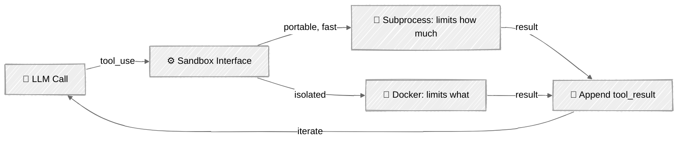

<!-- ---
title: "Sandboxing"
description: "Run agent-generated code and tool calls in isolation with resource limits and timeouts"
icon: "shield"
--- -->

# Sandboxing

The moment an agent can run code, your laptop runs whatever the model writes, including anything a prompt-injected web page talked it into. [Hooks](../02-hooks-lifecycle/) can express policy, but a regex can't reason about what arbitrary Python will do. To contain arbitrary code you need a boundary outside the code.

This tutorial builds two tiers behind one interface, then attacks both so you can see what each one really stops.

## 🎯 What You'll Learn

- Contain execution with `subprocess`, `resource.setrlimit`, and a stripped environment
- Enforce CPU, memory, and wall-clock limits on agent-run code
- Add an optional Docker (`--network none`) tier for a real isolation boundary
- Understand what each tier actually protects against — and what it doesn't

## 📦 Available Examples

| Provider | File | Description |
| -------- | ---- | ----------- |
| | [01_sandbox_attacks.py](01_sandbox_attacks.py) | Run hostile snippets through each tier and report what got out (no API key) |
|  | [02_sandboxed_agent_anthropic.py](02_sandboxed_agent_anthropic.py) | An agent whose only way to run code is the sandbox |
| | [shared/sandbox.py](shared/sandbox.py) | `SubprocessSandbox` and `DockerSandbox` behind one `Sandbox` interface |

## 🚀 Quick Start

> **Prerequisites:** Python 3.11+, API keys, and uv. See [SETUP.md](../../SETUP.md) for full setup instructions. These scripts need macOS or Linux: `resource` isn't available on Windows, so use WSL.

```bash
uv run --directory 05-loop-engineering/03-sandboxing python {script_name}

# Example
uv run --directory 05-loop-engineering/03-sandboxing python 01_sandbox_attacks.py
```

Or use the [Code Runner](https://marketplace.visualstudio.com/items?itemName=formulahendry.code-runner) VS Code extension to run the currently open script with a single click.

To include the container tier, start Docker and pull the image first. The sandbox's wall clock also covers container startup, so an image pull during the first run would count as a timeout.

```bash
docker pull python:3.12-slim
```

```bash
uv run --directory 05-loop-engineering/03-sandboxing python 02_sandboxed_agent_anthropic.py --docker
```

## 🔑 Key Concepts

### 1. Know Your Threat Model

Containment answers two separate questions, and a resource limit only answers the first:

- **How much** can this code use? (CPU, memory, disk, time, processes)
- **What** can this code touch? (files, network, other processes, secrets)

Here's what `01_sandbox_attacks.py` reports for the subprocess tier on macOS:

```
 Attack                           subprocess
 Read parent's env vars           ✅ blocked
 Burn CPU forever                 ✅ killed (CPU time)
 Sleep forever                    ✅ killed (wall-clock)
 Allocate 1.5 GB of memory        ✅ killed (memory)
 Write a 50 MB file               ✅ blocked   OSError: File too large
 Spawn a child process            ✅ blocked   BlockingIOError
 Read a file outside the workdir  ❌ escaped
 Open a network connection        ❌ escaped
```

Those last two rows are the most important in the tutorial. **The subprocess tier stops accidents and runaway code, but it isn't a security boundary.** Code in it can still read your SSH keys and send them anywhere.

### 2. Tier 1: Subprocess with Limits

Each protection has a specific job:

| Protection | Mechanism | Stops |
|-----------|-----------|-------|
| Stripped environment | `env={"PATH": ..., "HOME": ...}` allowlist | API keys leaking from `os.environ` |
| Fresh directory | `tempfile.TemporaryDirectory` | Files left behind between runs |
| CPU limit | `RLIMIT_CPU` | Busy loops |
| Wall clock | Parent polls and kills the process group | Sleeping or blocked code, which burns no CPU |
| Memory | `RLIMIT_AS`, plus a parent RSS watchdog | Allocation bombs |
| File size | `RLIMIT_FSIZE` | Filling the disk and flooding stdout |
| Process count | `RLIMIT_NPROC = 0` | Fork bombs and shelling out |

The limits are applied by a small bootstrap inside the child, which then `exec`s the untrusted program:

```python
BOOTSTRAP = """
import os, resource, sys
...
resource.setrlimit(resource.RLIMIT_CPU, (cpu, cpu + 1))
limit("RLIMIT_NPROC", 0)
os.execv(sys.executable, [sys.executable, "-I", "main.py"])
"""
```

Limits survive `exec`, so the program inherits them and has no chance to run first. Examples often use `subprocess`'s `preexec_fn` instead, but Python's documentation warns it can deadlock when threads are present, and agents that run tools in parallel usually have threads.

### 3. Where the Theory Meets the Platform

Rlimits aren't equally portable. On macOS, setting `RLIMIT_AS` raises `ValueError`, so memory isn't capped by the kernel at all. That's why the parent also watches from the outside:

```python
def check() -> str | None:
    ...
    return "memory" if read_rss_mb(pid) > self.limits.memory_mb else None
```

The watchdog only samples every 100 ms, so a fast allocation can overshoot the limit before it's killed. On Linux the rlimit is a hard stop and the watchdog is a backup. `RLIMIT_NPROC` has a quirk too: it counts all of a user's processes and doesn't apply to root. If you can't verify a limit on your platform, don't rely on it.

stdout and stderr go to files rather than pipes, which keeps an output flood from piling up in the parent's memory. Only a capped amount is read back for the model.

### 4. Tier 2: A Real Boundary

A container answers the "what can it touch?" question:

```python
["docker", "run", "--rm", "-i",
 "--network", "none",             # No network at all
 "--memory", "256m",              # Enforced by cgroups, on every platform
 "--memory-swap", "256m",         # ...with no swap to overflow into
 "--pids-limit", "64",            # Bounds fork bombs
 "--read-only",                   # Immutable root filesystem
 "--tmpfs", "/tmp:size=16m",      # A small scratch area
 "--cap-drop", "ALL",             # No Linux capabilities
 "--security-opt", "no-new-privileges",
 "--user", "65534:65534",         # Not root
 "python:3.12-slim", "python", "-I", "-"]
```

The code arrives on stdin, so no host path is mounted. The host's files simply aren't there to read, and there's no network to send them over.



| | Subprocess | Docker | gVisor / Firecracker |
|---|---|---|---|
| Startup | Milliseconds | Hundreds of ms | Hundreds of ms and up |
| Reads host files | ❌ Yes | ✅ No | ✅ No |
| Reaches the network | ❌ Yes | ✅ No | ✅ No |
| Kernel attack surface | Full | Full (shared kernel) | Reduced or separate kernel |
| Use for | Your own trusted tasks | Untrusted code on your machine | Multi-tenant production |

### 5. Violations Are Tool Results

A killed run is information for the model, so it comes back through the normal channel. The agent can read it and change approach, and nothing crashes on the host:

```python
tool_results.append({
    "type": "tool_result",
    "tool_use_id": block.id,
    "content": result.to_tool_result(),  # "killed: exceeded the CPU time limit"
    "is_error": bool(result.violation) or result.exit_code != 0,
})
```

The third example task shows this: naive recursive Fibonacci hits the CPU limit, and the agent has to work out why and pick a better algorithm.

## ⚠️ Important Considerations

- **Containers share the host kernel** — a kernel exploit escapes. For untrusted multi-tenant code, use gVisor, Firecracker, or a hosted sandbox.
- **Sandbox output can carry prompt injection** — anything the code prints goes into the conversation. The containment here protects your machine, not the model's judgment.
- **`RLIMIT_NPROC = 0` breaks real libraries** — NumPy's thread pools, for example, count as processes on Linux. Loosen the limit if your workload needs them.
- **Don't mount your project read-write** — the moment you do, the agent can damage it. Copy files in and diff them back out instead.
- **Network off isn't always realistic** — agents that install packages need egress. Route it through an allowlisting proxy instead of removing `--network none`.

## 🔗 Resources

- [Python `resource` module](https://docs.python.org/3/library/resource.html) — Which limits exist and how they behave
- [Python `subprocess` security and `preexec_fn` notes](https://docs.python.org/3/library/subprocess.html#subprocess.Popen) — Why `preexec_fn` is unsafe with threads
- [Docker Runtime Resource Constraints](https://docs.docker.com/engine/containers/resource_constraints/) — Memory, CPU, and swap flags
- [gVisor](https://gvisor.dev/) — A user-space kernel that reduces the host's attack surface
- [Firecracker](https://firecracker-microvm.github.io/) — The microVM behind AWS Lambda
- [Beyond Permission Prompts: Making Claude Code More Secure and Autonomous — Anthropic](https://www.anthropic.com/engineering/claude-code-sandboxing) — Filesystem and network isolation in a production agent

## 👉 Next Steps

Continue to **[MCP Integration](../04-mcp/)** to give your contained agent a way to reach the outside world through tools you choose.

**Experiments to try:**

- Add a `write_outside` attack and watch the subprocess tier fail it too
- Lower `memory_mb` to 16 and find out how little Python needs to start
- Give the agent a `pip_install` tool that runs in the container tier, and think through what that requires of `--network none`
