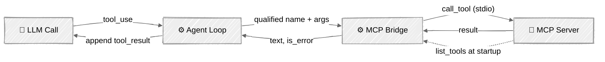

<!-- ---
title: "MCP Integration"
description: "Discover tools from Model Context Protocol servers and publish your own"
icon: "plug"
--- -->

# MCP Integration

Every tool so far has been a schema and a function you wrote yourself, inside one agent. The Model Context Protocol (MCP) separates the two: a *server* publishes tools, and any *client* can discover and call them at runtime. Write a tool once and it works with your agent, Claude Code, and anything else that speaks MCP.

This tutorial builds both sides, plus the small bridge that connects them to an agent loop.

## 🎯 What You'll Learn

- Use the `mcp` Python SDK client to list and call tools over a session
- Bridge MCP tool schemas into the agent loop for both Anthropic and OpenAI
- Build a small MCP server with `MCPServer` (called `FastMCP` before mcp 2.0)
- Compare the SDK-bridge approach with Anthropic's native MCP connector

## 📦 Available Examples

| Provider | File | Description |
| -------- | ---- | ----------- |
| | [01_mcp_server.py](01_mcp_server.py) | A task-tracker MCP server the agents launch over stdio |
|  | [02_mcp_agent_anthropic.py](02_mcp_agent_anthropic.py) | Agent that discovers its tools from MCP, on the Messages API |
|  | [03_mcp_agent_openai.py](03_mcp_agent_openai.py) | The same server and bridge, on the Responses API |
| | [shared/mcp_bridge.py](shared/mcp_bridge.py) | Client connections, schema translation, and call routing |

## 🚀 Quick Start

> **Prerequisites:** Python 3.11+, API keys, and uv. See [SETUP.md](../../SETUP.md) for full setup instructions.

```bash
uv run --directory 05-loop-engineering/04-mcp python {script_name}

# Example
uv run --directory 05-loop-engineering/04-mcp python 02_mcp_agent_anthropic.py
```

Or use the [Code Runner](https://marketplace.visualstudio.com/items?itemName=formulahendry.code-runner) VS Code extension to run the currently open script with a single click.

You don't need to start the server yourself: each agent script launches it as a subprocess. Tool discovery runs without an API key, so you can check the connection first.

## 🔑 Key Concepts

### 1. How the Pieces Connect



The loop is the same one from [Foundations](../../01-foundations/05-agent-loop/). The only new part is where the tools come from: `list_tools()` at startup instead of a hard-coded list.

### 2. Publishing a Server

`MCPServer` builds the JSON schema from your type hints and docstring:

```python
from mcp.server.mcpserver import MCPServer

mcp = MCPServer("task-tracker")

@mcp.tool()
def add_task(title: str, priority: Priority = "medium") -> dict[str, object]:
    """Add a task to the tracker and return it."""
    return asdict(store.add(title, priority))

mcp.run(transport="stdio")
```

Two details will catch you out:

- **On stdio, stdout is the protocol.** A stray `print()` corrupts the session, so all logging must go to stderr.
- **Only `ToolError` messages reach the client.** Any other exception reports a generic failure and hides the details, which is a safe default for internal errors. Raise `ToolError` when the model needs to know what went wrong.

### 3. Connecting as a Client

The client talks to a server through a single async context manager:

```python
from mcp import Client, StdioServerParameters

params = StdioServerParameters(command=sys.executable, args=["01_mcp_server.py"])

async with Client(params) as client:
    listing = await client.list_tools()
    result = await client.call_tool("add_task", {"title": "Ship it"})
```

Pass a URL instead of `StdioServerParameters` to connect to a remote server over Streamable HTTP.

### 4. Bridging Schemas to Each Provider

An MCP tool's `input_schema` is already JSON Schema, so the bridge is mostly renaming:

```python
# Anthropic Messages API
{"name": name, "description": description, "input_schema": tool.input_schema}

# OpenAI Responses API
{"type": "function", "name": name, "description": description,
 "parameters": tool.input_schema, "strict": False}
```

`strict: False` matters for OpenAI: strict mode requires every property to be listed in `required`, while MCP schemas routinely have optional parameters like `priority` above.

The bridge also prefixes each tool with its server (`tracker__add_task`), so two servers can both offer a `search` tool, and uses that prefix to route calls back to the right server.

### 5. MCP Tools Are Untrusted Input

Connecting a server gives its author direct influence over your agent: tool descriptions reach the model as instructions, and tool results flow into the conversation. A malicious or compromised server can use either one for prompt injection. The bridge takes a first step with an allowlist:

```python
MCPBridge(SERVERS, allowed_tools={"tracker__list_tasks", "tracker__add_task"})
```

Hiding a tool is stronger than blocking its calls, because a hidden tool's description never reaches the model. For the rest, register [hooks](../02-hooks-lifecycle/) around MCP calls just as you would around local tools, and only connect servers you'd trust to run code on your machine: with stdio, that's what they're doing.

### 6. SDK Bridge vs. Native MCP Connector

Anthropic's API can also connect to a *remote* MCP server itself:

```python
response = client.beta.messages.create(
    model="claude-opus-5-5",
    max_tokens=16000,
    betas=["mcp-client-2025-11-20"],
    mcp_servers=[{"type": "url", "url": "https://example.com/mcp", "name": "docs"}],
    tools=[{"type": "mcp_toolset", "mcp_server_name": "docs"}],
    messages=[{"role": "user", "content": "What changed in the latest release?"}],
)
```

| | SDK bridge (this tutorial) | Native connector |
|---|---|---|
| Who connects to the server | Your process | Anthropic's API |
| Local stdio servers | ✅ Yes | ❌ No, needs a public URL |
| Who runs the tool loop | Your code | The API, within a single request |
| Hooks and approvals around each call | ✅ Yes | Limited to per-tool config |
| Works across model providers | ✅ Yes | ❌ Anthropic only |
| Code you have to maintain | The bridge | Almost none |

Use the connector for a remote server you trust when you don't need to intervene between calls. Use the bridge when you need control: local servers, or the hooks, sandboxing, and auditing this module is about.

## ⚠️ Important Considerations

- **Freeze tools at session start** — the tool list is part of the prefix that prompt caching and thinking-block validation depend on, so changing it mid-conversation throws both away.
- **Large tool lists are expensive** — every schema is sent with every request. Connecting ten servers can cost thousands of tokens per call before any work happens.
- **Tool results can be huge** — apply the truncation strategies from [Context Engineering](../../03-advanced-techniques/03-context-engineering/) to anything a server returns.
- **The SDK moves quickly** — mcp 2.0 renamed `FastMCP` to `MCPServer` and changed the client API. Older tutorials online show `ClientSession` and `from mcp.server.fastmcp`, and those won't run on this version.
- **Remote servers need authentication** — real deployments use OAuth over Streamable HTTP. The stdio transport used here gets its security from running locally.

## 🔗 Resources

- [Model Context Protocol](https://modelcontextprotocol.io/) — Overview and concepts
- [MCP Specification](https://modelcontextprotocol.io/specification/) — Transports, lifecycle, and message formats
- [MCP Python SDK](https://github.com/modelcontextprotocol/python-sdk) — The client and server library used here
- [MCP Connector — Anthropic](https://platform.claude.com/docs/en/agents-and-tools/mcp-connector) — The native approach in section 6
- [MCP Server Registry](https://github.com/modelcontextprotocol/servers) — Reference servers you can connect to

## 👉 Next Steps

Continue to **[Subagents & Delegation](../05-subagents/)**. More tools means more output in context, and delegation is how you keep that manageable.

**Experiments to try:**

- Add a second entry to `SERVERS` and let the agent use tools from both
- Call the server's tools by hand with the [MCP Inspector](https://github.com/modelcontextprotocol/inspector): `npx @modelcontextprotocol/inspector uv run python 01_mcp_server.py`, from this folder
- Connect this server to Claude Code with `claude mcp add` and use it from there, with no changes to the server
- Pass `allowed_tools` to the bridge and see how the agent handles a missing capability
