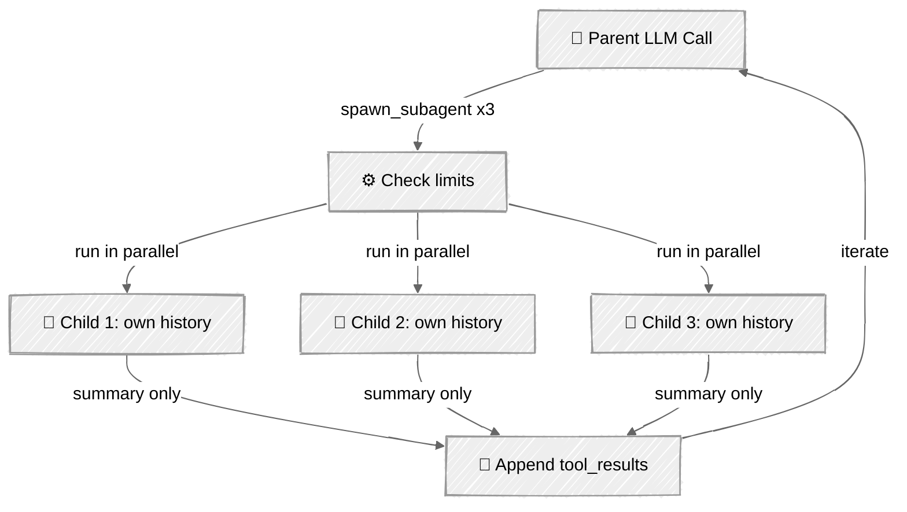

<!-- ---
title: "Subagents & Delegation"
description: "Spawn child loops with isolated context that run a subtask and return a summary"
icon: "users"
--- -->

# Subagents & Delegation

Ask an agent to compare three modules and it reads a dozen files. All of that text stays in its context, gets resent on every later call, and crowds out the actual question. A subagent fixes this: a `spawn_subagent` tool starts a fresh agent loop that does the reading and hands back only a summary.

The parent gets the conclusion, without the transcript that produced it.

## 🎯 What You'll Learn

- Model a parent agent spawning child agents with isolated context
- Return compact summaries instead of full child transcripts
- Enforce delegation depth and fan-out limits
- Aggregate child token usage into the parent's report

## 📦 Available Examples

| Provider | File | Description |
| -------- | ---- | ----------- |
|  | [01_subagents_anthropic.py](01_subagents_anthropic.py) | A parent that delegates codebase research to parallel children |

## 🚀 Quick Start

> **Prerequisites:** Python 3.11+, API keys, and uv. See [SETUP.md](../../SETUP.md) for full setup instructions.

```bash
uv run --directory 05-loop-engineering/05-subagents python 01_subagents_anthropic.py
```

Or use the [Code Runner](https://marketplace.visualstudio.com/items?itemName=formulahendry.code-runner) VS Code extension to run the currently open script with a single click.

The agents explore the `01-foundations` module, read-only. Try the first and third examples and compare the usage trees: the first should fan out, while the third is small enough that the parent should just do it.

## 🔑 Key Concepts

### 1. A Subagent Is Just a Tool

From the parent's point of view, `spawn_subagent` is an ordinary tool: a string goes in and a string comes out. What's different is what runs in between: a whole agent loop.



### 2. Isolation Comes from a New Message List

There's no special isolation mechanism. Each child starts with its own list:

```python
def run(self, task: str) -> str:
    # This list is the isolation: a child starts from its task, with none of the parent's turns
    messages = [{"role": "user", "content": task}]
```

This has a consequence you must design for: **a child knows only what's in its task string.** It can't see the conversation, the user's request, or what its siblings are doing. That's why the tool description says so explicitly, and why the parent's prompt tells it to include the goal and the paths to look at. Most poor subagent results come down to a vague brief.

### 3. The Summary Is the Contract

The child's final message is the only thing that crosses back, so the child's prompt says so. That's a request, so the limit is also enforced in code:

```python
# Enforced in code because the prompt's size limit is only a request
if len(summary) > MAX_SUMMARY_CHARS:
    summary = f"{summary[:MAX_SUMMARY_CHARS]}\n... [summary truncated]"
```

Without this cap, a chatty child can put back everything you delegated to keep out of the parent's context.

### 4. Three Limits on Runaway Delegation

Agents that can create agents can multiply fast, and each one costs money:

| Limit | Default | Guards against | How it's enforced |
|-------|---------|---------------|-------------------|
| `max_depth` | 2 | Children spawning children spawning children | Agents at the limit don't get the tool |
| `max_fan_out` | 4 | One turn spawning a crowd | Extra calls get an `is_error` result |
| `max_total_agents` | 8 | Many small fan-outs adding up | A shared, locked counter |

Removing the tool at max depth is stronger than refusing the call: the agent never spends a turn trying. Refusals still need a `tool_result`, because the API rejects a request where any `tool_use` has no matching result.

### 5. Parallel Children, One Result Message

The model can ask for several subagents in one turn. They run on a thread pool, and all results go back in **a single user message**, in the original order:

```python
with ThreadPoolExecutor(max_workers=len(accepted)) as pool:
    futures = {
        block.id: pool.submit(self.spawn, block.input.get("task", ""), number)
        for number, block in enumerate(accepted, first)
    }
    results.update({block_id: f.result() for block_id, f in futures.items()})
```

Splitting tool results across several messages works, but it teaches the model to stop making parallel calls. The Anthropic client is safe to share between threads, and the only shared state here is the budget counter, which has a lock.

### 6. Usage Rolls Up, Context Doesn't

Each child's token usage stays out of the parent's context, but it still shows up on your bill. An `AgentNode` tree tracks both:

```
parent  7,153 tokens  (last request 4,097 input)
├── parent.1  6,540 tokens  (last request 3,534 input)
├── parent.2  17,319 tokens  (last request 8,435 input)
└── parent.3  16,636 tokens  (last request 7,016 input)
```

That's a real run of the first example. For comparison, a run where the parent read everything itself used 22,327 tokens, with a last request of 9,670 input tokens.

| | Parent's last request | Total tokens |
|---|---|---|
| Parent reads everything | 9,670 | 22,327 |
| Three subagents | 4,097 | 47,648 |

**Delegation doesn't make work cheaper.** Here it cut the parent's context by more than half and roughly doubled the total, because each child starts with its own prompt and rediscovers context. What you buy is a clean parent context and parallel speed. Your numbers will vary from run to run.

Children use `CHILD_EFFORT = "low"` because narrow reading tasks rarely need deep reasoning. It's a useful first lever to try before reaching for a separate, cheaper model.

## ⚠️ Important Considerations

- **Say exactly when to delegate** — an early version of this prompt said "do small lookups yourself", and on one run the parent read every file and spawned nothing. A concrete rule ("more than one folder") fixed it.
- **Delegate reading, not decisions** — subagents suit work that's independent and output-heavy. If the steps depend on each other, a single agent with full context does better.
- **Give children the fewest tools you can** — these children are read-only. Parallel children that write to the same files will overwrite each other.
- **Summaries can lose detail** — a child that misreads something passes its mistake up as fact, and the parent can't check it. Ask for the file paths behind each claim.
- **Children read untrusted content** — a child's summary can carry prompt injection into the parent. Isolation limits how much gets through, but it doesn't filter what does.
- **A failed child isn't a failed parent** — API errors come back as `is_error` results, and the parent decides whether to retry or carry on without that piece.
- **Threads are fine here** — the work is mostly waiting on the network. The [capstone](../07-extensible-agent/) uses `asyncio` instead, because MCP calls are async.

## 🔗 Resources

- [How We Built Our Multi-Agent Research System — Anthropic](https://www.anthropic.com/engineering/multi-agent-research-system) — Lessons on delegation, briefs, and costs from production
- [Building Effective Agents — Anthropic](https://www.anthropic.com/engineering/building-effective-agents) — When orchestrator-workers is the right pattern
- [Claude Code Subagents](https://code.claude.com/docs/en/sub-agents) — How a production harness configures and scopes subagents
- [Orchestrator-Workers](../../02-effective-agents/04-orchestrator-workers/) — The fixed-workflow version of this idea

## 👉 Next Steps

Continue to **[Context Compaction](../06-context-compaction/)**. Delegation keeps context from growing so quickly, and compaction handles it when it grows anyway.

**Experiments to try:**

- Set `max_depth` to 1, then 3, and see how the tree changes on the same task
- Remove the summary cap and write a task that makes a child return a long report
- Run the first example with `spawn_subagent` removed and compare the parent's last request size
