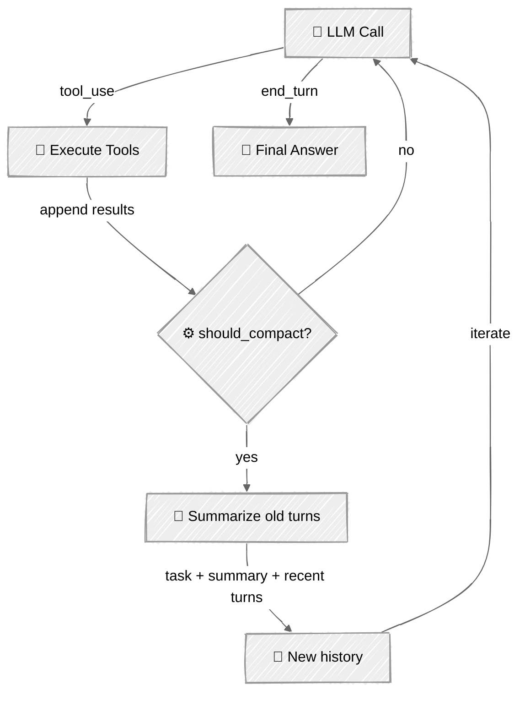

<!-- ---
title: "Context Compaction"
description: "Keep long-running loops alive by compacting their own history mid-run"
icon: "scissors"
--- -->

# Context Compaction

[Context Engineering](../../03-advanced-techniques/03-context-engineering/) managed a chat, where history grows one question at a time. An autonomous loop is different: it can read a dozen long files with no human in the loop, and each one is resent on every later request. Without intervention the loop gets steadily more expensive, and eventually the API rejects it.

Compaction is the loop's own escape hatch. When the history gets too large, the agent summarizes its older turns and carries on with the summary in their place.

## 🎯 What You'll Learn

- Trigger compaction as a loop-lifecycle event with a `should_compact()` check
- Summarize old turns while pinning the system prompt and current task
- Preserve `tool_use`/`tool_result` pairing to avoid API errors
- Handle compaction on the OpenAI Responses API by resending a compacted input

## 📦 Available Examples

| Provider | File | Description |
| -------- | ---- | ----------- |
|  | [01_compaction_anthropic.py](01_compaction_anthropic.py) | Client-side compaction on the Messages API, plus an offline pairing demo |
|  | [02_compaction_openai.py](02_compaction_openai.py) | The same technique on the Responses API, using `store=False` |
| | [shared/incident_data.py](shared/incident_data.py) | Simulated logs that are long enough to overflow a small budget |

## 🚀 Quick Start

> **Prerequisites:** Python 3.11+, API keys, and uv. See [SETUP.md](../../SETUP.md) for full setup instructions.

```bash
uv run --directory 05-loop-engineering/06-context-compaction python {script_name}

# Example
uv run --directory 05-loop-engineering/06-context-compaction python 01_compaction_anthropic.py
```

Or use the [Code Runner](https://marketplace.visualstudio.com/items?itemName=formulahendry.code-runner) VS Code extension to run the currently open script with a single click.

The agent investigates a simulated outage across eight services, under a deliberately small 15,000-token budget. Add `--no-compaction` to run the same task without it, then compare the two reports. The offline pairing demo in the Anthropic script needs no API key.

## 🔑 Key Concepts

### 1. A Lifecycle Event in the Loop

Compaction fits at one specific place in the loop: after the tool results are appended, before the next model call.



The check itself uses numbers the API already gave you:

```python
def should_compact(self, usage) -> bool:
    return self.context_tokens(usage) > COMPACT_THRESHOLD_TOKENS

@staticmethod
def context_tokens(usage) -> int:
    # Cached tokens are cheaper, but they still occupy the context window
    return (usage.input_tokens
            + (usage.cache_read_input_tokens or 0)
            + (usage.cache_creation_input_tokens or 0))
```

### 2. What Gets Kept

```
Before                               After
──────                               ─────
system prompt ──── frozen ─────────→ system prompt (byte-identical)
tools ──────────── frozen ─────────→ tools (byte-identical)
user: task                           user: task (word for word)
assistant: read logs A                     + <progress_summary>
user: result A         ┐ summarized
assistant: read logs B ┘
...
assistant: read logs G ─ stripped ─→ assistant: read logs G (no thinking)
user: result G ──────── kept ──────→ user: result G
```

**Pin the task.** Summaries drift. If the task only lived in the summary, each compaction would paraphrase a paraphrase, and the agent could end up working on something subtly different. Keeping the original text word for word prevents that.

**Tell the summarizer what matters.** Whatever it leaves out is gone for good, so the prompt asks for exact identifiers, numbers, and error messages. The demo buries facts in early logs so you can check that the final report still has them.

### 3. Never Split a Tool Call from Its Result

The API rejects a `tool_result` with no matching `tool_use`, and any `tool_use` without a result. A naive "keep the last N messages" will eventually cut between them:

```python
def find_safe_split(messages, keep_recent_rounds):
    """Find where to cut so a tool_use is never separated from its tool_result."""
    round_starts = [i for i, m in enumerate(messages) if is_tool_round_start(m)]
    if len(round_starts) < keep_recent_rounds + 2:
        return None
    return round_starts[-keep_recent_rounds]
```

Cutting only at an assistant message that starts a tool round guarantees that each kept call still has its result. The Anthropic script prints this comparison before it starts, without any API calls. It also runs a `find_pairing_errors` check on every compacted history, so a bug here fails loudly and immediately instead of as a confusing API error.

### 4. Why Retained Turns Lose Their Thinking

This is the subtlest part, and it's new with recent Claude models. A thinking block's signature records the conversation prefix that produced it: the system prompt, the tools, and every message before it. Summarize the older turns and the prefix behind the retained turns changes, so replaying their thinking blocks can fail with a 400, even though those turns themselves haven't changed.

So retained turns keep their text and tool calls but drop thinking:

```python
compacted = [
    {"role": "user", "content": anchor},
    *[strip_thinking(m) for m in messages[split:]],
]
```

To see it fail, change `strip_thinking` to return the message untouched. Accounts created before August 31, 2026 don't enforce this by default, so opt in to test from any account:

```python
response = client.beta.messages.create(
    ...,
    betas=[FALLBACK_BETA, "thinking-binding-controls-2026-08-01"],
    thinking={"type": "adaptive", "block_binding": {"prefix_mismatch_behavior": "error"}},
)
```

With the check on, this tutorial's history is accepted, and the untouched version gets a 400: ``Invalid `signature` in `thinking` block``. Build new harnesses with the check on, so that an accidental history edit fails immediately.

Two related rules for the loop as a whole:

- **Only compact at a round boundary.** An assistant turn still waiting on its tool result has to go back with its thinking intact.
- **Never edit the system prompt or tools to "help" compaction.** Both are part of the same prefix, which is why the summary goes in a user message.

Compaction also resets the prompt cache, since the prefix has changed. That's the real cost of compacting too eagerly.

### 5. OpenAI: You Have to Own the History

The [Foundations agent](../../01-foundations/05-agent-loop/) used `previous_response_id`, which is convenient, but the server holds the conversation, so you have nothing to compact. The fix is to keep the history yourself:

```python
response = client.responses.create(
    model=MODEL,
    instructions=SYSTEM_PROMPT,
    tools=TOOLS,
    input=items,     # The whole conversation, every time
    store=False,     # No server-side history
)
items.extend(item.model_dump(exclude_none=True) for item in response.output)
```

Compacting then just means sending a shorter list. Pairing works the same way, using `call_id` to match `function_call` with `function_call_output`. Here are real runs of each script:

```
OpenAI                                     Anthropic
 Iteration   Tokens                         Iteration   Tokens
         4   12,070                                 3   13,085
         5   15,948  🗜️ compacted after this        4   19,146  🗜️ compacted after this
         6    4,628                                 5    7,355
```

The Anthropic run compacted twice, kept every request under 20,000 tokens, and still reported facts it read before the first compaction.

### 6. Let the Server Do It

Hand-written compaction shows you the mechanics, and it's a reasonable choice when you need full control over what's kept. In production on the Claude API, consider server-side compaction first: the API summarizes for you, and your code just has to keep appending:

```python
response = client.beta.messages.create(
    model="claude-opus-5-5",
    max_tokens=16000,
    betas=["compact-2026-01-12"],
    context_management={"edits": [{"type": "compact_20260112"}]},
    messages=messages,
)
# Append the full content: the compaction block replaces older turns on the next request
messages.append({"role": "assistant", "content": response.content})
```

| | Client-side (this tutorial) | Server-side |
|---|---|---|
| Control over what's kept | Complete | Via `instructions` |
| Works across providers | ✅ Yes | Provider-specific |
| Thinking-block handling | Yours to get right | Handled for you |
| Beta dependency | None | Yes |
| Simplest shape | Summary only, keeping no recent turns | Automatic |

If you stay client-side, you can also drop the tail entirely: set `KEEP_RECENT_ROUNDS = 0` for what Anthropic calls *simple compaction*, where the next request is only the task and summary. It has no retained turns to get wrong.

## ⚠️ Important Considerations

- **The threshold here is unrealistically low** — it's set so the demo triggers quickly. Compact too eagerly and you lose detail and your cache hit rate. Real agents wait until a large share of the window is used.
- **Summaries are lossy, and can be wrong** — a mistaken summary becomes the agent's memory. Keep anything critical on disk: a progress file survives any compaction.
- **Compaction costs tokens** — every summary is a model call. Summaries use low effort, which is usually enough since the job is extraction.
- **One giant tool result can overshoot** — compaction runs after results are appended, so cap tool output as well (see [Context Engineering](../../03-advanced-techniques/03-context-engineering/)).
- **Reasoning models on OpenAI need more care** — with `store=False`, you must also request `include=["reasoning.encrypted_content"]` and keep each reasoning item next to its function call. `find_safe_split` handles the second part.
- **Multiple compactions compound** — the second summary is built from the first, so facts can fade over a very long session.

## 🔗 Resources

- [Compaction — Anthropic](https://platform.claude.com/docs/en/build-with-claude/compaction) — Server-side compaction, triggers, and custom instructions
- [Context Editing — Anthropic](https://platform.claude.com/docs/en/build-with-claude/context-editing) — Clearing old tool results as a lighter alternative
- [Effective Context Engineering for AI Agents — Anthropic](https://www.anthropic.com/engineering/effective-context-engineering-for-ai-agents) — Where compaction fits among context strategies
- [Conversation State — OpenAI](https://platform.openai.com/docs/guides/conversation-state) — Managing history yourself vs. `previous_response_id`
- [Context Engineering](../../03-advanced-techniques/03-context-engineering/) — The chat-oriented foundation for this tutorial

## 👉 Next Steps

Continue to **[Extensible Agent](../07-extensible-agent/)** 🏆 to combine everything in this module into one agent.

**Experiments to try:**

- Set `KEEP_RECENT_ROUNDS = 0` and compare the final report with a run that keeps recent turns
- Weaken `SUMMARY_PROMPT` to "Summarize this briefly" and see which buried facts disappear
- Have the agent write findings to a notes file with a new tool, and compare how well they survive
