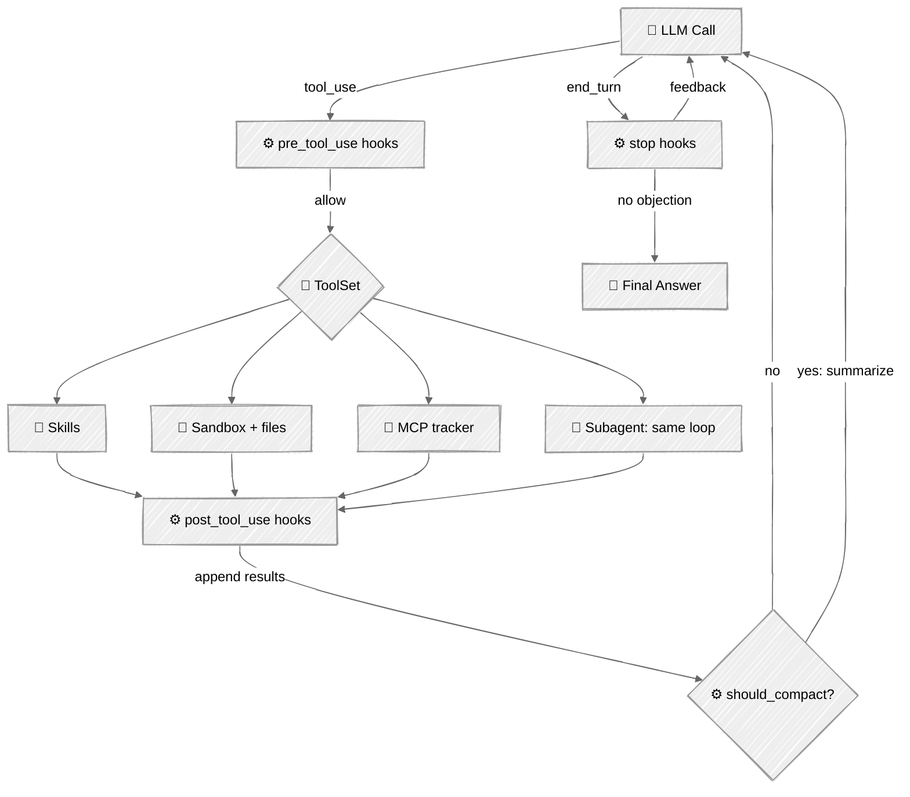

<!-- ---
title: "Extensible Agent"
description: "Capstone — one agent wired with skills, hooks, sandbox, MCP, subagents, and compaction"
icon: "boxes"
--- -->

# Extensible Agent 🏆

**Capstone.** Every tutorial in this module added one control surface to the agent loop. Here they all go into a single agent: skills for expertise, hooks for control, a sandboxed executor for safety, MCP-discovered tools for reach, subagent delegation for scale, and automatic compaction for endurance.

The scenario is a real maintenance task: triage the open issues in an issue tracker against a small Python project, proving each verdict by running code.

## 🎯 What You'll Learn

- Wire skills, hooks, sandboxing, MCP, subagents, and compaction into one coherent loop
- Keep the composition clean — each primitive stays an independent, swappable layer
- Drive an end-to-end task that exercises every control surface at once
- Recognize which harness concerns a framework would (and wouldn't) abstract away

## 📦 Available Examples

| Provider | File | Description |
| -------- | ---- | ----------- |
|  | [01_extensible_agent.py](01_extensible_agent.py) | Entry point: assembles the layers, sets policy, and reports what each one did |
| | [extensible_agent/agent.py](extensible_agent/agent.py) | The loop, which knows only tools, hooks, and compaction |
| | [extensible_agent/tools.py](extensible_agent/tools.py) | The `Tool` contract every layer shares |
| | [extensible_agent/hooks.py](extensible_agent/hooks.py) | Layer: lifecycle hooks |
| | [extensible_agent/skills.py](extensible_agent/skills.py) | Layer: progressive skill disclosure |
| | [extensible_agent/workspace.py](extensible_agent/workspace.py) | Layer: read-only project access and the sandbox |
| | [extensible_agent/mcp_layer.py](extensible_agent/mcp_layer.py) | Layer: tools discovered over MCP |
| | [extensible_agent/delegation.py](extensible_agent/delegation.py) | Layer: subagents |
| | [extensible_agent/compaction.py](extensible_agent/compaction.py) | Layer: history compaction |
| | [scenario/](scenario/) | The buggy project, the tracker MCP server, and the triage skill |

## 🚀 Quick Start

> **Prerequisites:** Python 3.11+, API keys, and uv. See [SETUP.md](../../SETUP.md) for full setup instructions. The sandbox needs macOS or Linux.

```bash
uv run --directory 05-loop-engineering/07-extensible-agent python 01_extensible_agent.py
```

Or use the [Code Runner](https://marketplace.visualstudio.com/items?itemName=formulahendry.code-runner) VS Code extension to run the currently open script with a single click.

This run makes many model calls, because it starts a subagent per issue. Without an API key, the script connects the layers and prints what it found, without calling a model. `--compact-at` defaults to an artificially low 4,000 tokens, so the coordinator normally compacts once. Raise it to turn compaction off in practice.

## 🏗️ Code Structure

```
07-extensible-agent/
├── 01_extensible_agent.py      # Composition root: wires the layers, defines policy
├── extensible_agent/
│   ├── agent.py                # The loop
│   ├── tools.py                # Tool and ToolSet: the shared contract
│   ├── hooks.py                # Registry for pre_tool_use, post_tool_use, stop
│   ├── skills.py               # Catalog, load_skill, read_skill_file
│   ├── workspace.py            # list_files, read_file, run_python
│   ├── mcp_layer.py            # MCP tools adapted to Tool
│   ├── delegation.py           # spawn_subagent
│   └── compaction.py           # should_compact and compact
└── scenario/
    ├── project/                # The code under investigation
    ├── skills/bug-triage/      # The procedure the coordinator follows
    └── tracker_server.py       # An external issue tracker, over MCP
```



## 🔑 Key Concepts

### 1. One Contract Holds It Together

Each capability reduces to the same thing: a schema and an async handler.

```python
@dataclass(frozen=True)
class Tool:
    name: str
    description: str
    input_schema: dict[str, Any]
    handler: ToolHandler
```

Skills, the sandbox, MCP tools, and even a whole child agent are all a `Tool`. The loop has no branches for any of them:

```python
content, is_error = await self.tools.call(block.name, block.input)
```

That single line is why the layers stay independent. Removing MCP means deleting one item from a list, and the loop never finds out.

### 2. The Composition Root

The wiring in `01_extensible_agent.py` is the most useful part to read. All the layers meet in one place:

```python
# Children get the workspace only. Without spawn_subagent, depth is capped at one, and
# without tracker tools, only the coordinator can change the tracker.
child_tools = ToolSet(workspace.tools())

delegation = DelegationLayer(root, build_child)
parent_tools = ToolSet([*skills.tools(), *workspace.tools(), *mcp.tools(), *delegation.tools()])
```

Notice what this does for you: **permissions become the tool list.** A child can't update the tracker or spawn agents, because those tools aren't in its set. There's nothing to check and nothing to bypass. The same goes for `tracker__delete_issue`: it isn't on the MCP allowlist, so no agent ever learns it exists.

### 3. The Layers Work Together

Composition earns its keep where one layer covers for another:

| Situation | First layer | Backstop |
|-----------|-------------|----------|
| Code tries to use the network | Hook denies it (policy) | Nothing yet: the subprocess tier has no network isolation, so this is where you'd switch to [Docker](../03-sandboxing/) |
| Code runs forever | The sandbox kills it (limit) | The agent reads the violation and changes approach |
| A file contains a secret | Hook redacts it before the model sees it | Children only return summaries, which limits how far anything spreads |
| The agent says it's finished too early | Stop hook checks the tracker calls | `MAX_STOP_BLOCKS` prevents an endless loop |
| Subagents read a lot of code | Delegation keeps it out of the parent | Compaction handles it if a child runs long |

A hook registered once applies to the whole agent tree, because children share the registry. The stop hook is the exception: `enforce_stop_hooks=False` on children, since "every issue is triaged" is the coordinator's job.

### 4. Everything Has to Stay Append-Only

Several layers would be easier to write by modifying the conversation, and all of them resist the temptation:

- Skills arrive as tool results, not system-prompt edits
- The tool list is frozen and sorted when a `ToolSet` is built
- Hooks change what gets appended, never what's already there
- Compaction is the only thing that rewrites history. It happens at a round boundary, and it strips thinking blocks from the turns it keeps

This keeps prompt caching effective and thinking blocks valid. It's the kind of cross-cutting rule that's easy to break when you add features one at a time, and it's a good reason to have one loop own the message list.

### 5. Should You Use a Framework Instead?

After building this, you can judge what a framework would and wouldn't do for you:

| Concern | A framework typically gives you | Still yours |
|---------|-------------------------------|-------------|
| The loop and tool plumbing | ✅ Yes | — |
| MCP client and schema conversion | ✅ Usually | Which servers to trust |
| Hooks and callbacks | ✅ Usually | The actual policy |
| Subagents | ✅ Often | Briefs, limits, and when to delegate |
| Compaction | ✅ Often | What the summary has to retain |
| Sandboxing | ⚠️ Sometimes | Your threat model and tier choice |
| Evals, cost control, your domain's rules | ❌ Rarely | All of it |

The plumbing is what's easy to replace. The judgment behind it is the part you've actually learned here, and it's what the [Frameworks](../../06-frameworks/) module will let you compare.

## ⚠️ Important Considerations

- **This run costs real money** — a parent and several subagents make many calls. Check the usage tree at the end, and lower `max_total_agents` while experimenting.
- **The subprocess tier isn't a security boundary** — it can still read host files and reach the network, and the network hook is only a regex. Use a container before pointing this at code you don't trust.
- **`scenario/project/settings.py` holds a fake key on purpose** — it exists to trigger the redaction hook. Redaction patterns only catch formats you've listed.
- **The stop hook trusts its own bookkeeping** — it counts `set_triage` calls, which doesn't prove the verdicts are right. Checking quality takes [evals](../../04-testing-evaluation/02-evals/).
- **Shared state needs care** — `asyncio.gather` runs tools concurrently, so hooks that keep state need to tolerate interleaving between awaits. Hooks here are synchronous, which makes them safe.
- **It's a teaching harness** — production agents also need persistence and resume, retries, tracing, and per-tenant limits. See [Production](../../07-production/).

## 🔗 Resources

- [Building Effective Agents — Anthropic](https://www.anthropic.com/engineering/building-effective-agents) — Why composable primitives beat elaborate frameworks
- [Effective Harnesses for Long-Running Agents — Anthropic](https://www.anthropic.com/engineering/effective-harnesses-for-long-running-agents) — How a real harness keeps agents productive across sessions
- [Writing Effective Tools for Agents — Anthropic](https://www.anthropic.com/engineering/writing-tools-for-agents) — Designing the tool surface this agent is built on
- [Claude Agent SDK](https://code.claude.com/docs/en/agent-sdk/overview) — These same primitives, packaged as a library

## 👉 Next Steps

You've built the harness from scratch. Continue to **[Frameworks](../../06-frameworks/)** to see how others package the same ideas, or **[Production](../../07-production/)** for what it takes to run one reliably.

**Experiments to try:**

- Add a layer of your own: a `web_search` tool, or a persistent memory from [Memory](../../03-advanced-techniques/05-memory/), and see how little the loop changes
- Swap the subprocess sandbox for the `DockerSandbox` from [tutorial 03](../03-sandboxing/), and delete the network hook
- Add a real approval gate on `tracker__set_triage` for `critical` verdicts
- Run with `--compact-at 2000` and check what the coordinator still knows when it writes the final table
