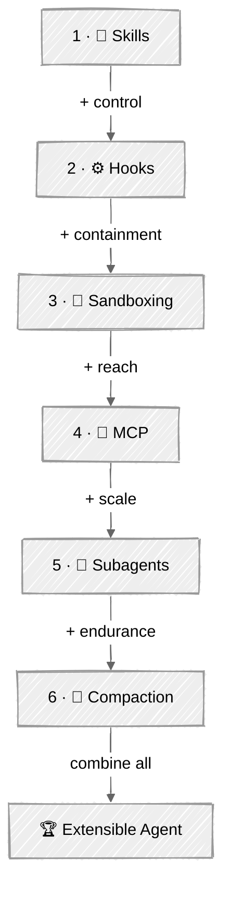

<!-- ---
title: "Loop Engineering"
description: "Harness the agent loop — add skills, MCP, sandboxing, subagents, hooks, and compaction one control surface at a time"
--- -->

# Loop Engineering

You built the bare agent loop in [Foundations](../01-foundations/05-agent-loop/). This module takes that loop and progressively *harnesses* it — each tutorial adds one orthogonal control surface that turns a naive loop into a real, extensible agent.

A raw loop calls the model, runs tools, and repeats. That's enough to demo — not to ship. Real agents inject capabilities on demand, run untrusted code safely, discover external tools, delegate work, expose control points, and survive long sessions without blowing the context window. These are the primitives behind Claude Code, Codex, and Copilot. Here you build each one from scratch so you understand exactly what the harness is doing before any framework hides it from you.

## 🗺️ Progression Path

| Step | Tutorial | What It Adds |
|:----:|----------|-------------|
| 1 | [Skills](01-skills/) | Expertise loaded on demand: catalog → instructions → bundled files |
| 2 | [Hooks & Lifecycle](02-hooks-lifecycle/) | + allow/deny/replace decisions at `pre_tool_use`, `post_tool_use`, and `stop` |
| 3 | [Sandboxing](03-sandboxing/) | + resource limits and isolation for code the agent writes |
| 4 | [MCP Integration](04-mcp/) | + tools discovered at runtime from external servers |
| 5 | [Subagents & Delegation](05-subagents/) | + child loops with isolated context that return only a summary |
| 6 | [Context Compaction](06-context-compaction/) | + history that summarizes itself so long runs can keep going |
| 🏆 | [Extensible Agent](07-extensible-agent/) | Combines every primitive into one composable agent |

## 💡 Tips for Success

1. **Read each diff against the bare loop** — every tutorial is the [Foundations loop](../01-foundations/05-agent-loop/) plus one idea, so find that idea first
2. **Run the offline parts first** — several scripts demonstrate their core mechanism without an API key, which makes them free to experiment with
3. **Keep the conversation append-only** — editing earlier turns, the system prompt, or the tool list costs you your prompt cache and can invalidate thinking blocks
4. **Separate policy from enforcement** — a hook says what's allowed, a sandbox makes the rest impossible, and you usually need both
5. **Give tools the least reach you can** — a capability an agent can't see is safer than one it's told not to use
6. **Treat everything that comes back as untrusted** — tool output, MCP descriptions, and subagent summaries can all carry prompt injection
7. **Watch the token counts** — delegation and compaction both trade tokens for something else, so check what you're actually paying
8. **Add layers only when you need them** — a loop with six control surfaces is not automatically better than one with two

## 📚 Tutorials

### [01 - Skills](01-skills/)

**What you'll learn:**
- Structure a `SKILL.md` with YAML front-matter and a Markdown body
- Implement three-tier progressive disclosure: catalog → load skill → read bundled files
- Give the agent tools to discover capabilities at runtime
- Guard skill loading against path traversal and keep the base prompt lean

**Evolution:** Adds capabilities without adding prompt: expertise costs tokens only when a task needs it

---

### [02 - Hooks & Lifecycle](02-hooks-lifecycle/)

**What you'll learn:**
- Design a hook registry mapping lifecycle events to callables
- Handle `pre_tool_use`, `post_tool_use`, and `stop` events
- Return allow / deny / replace decisions from a pre-tool-use hook
- Re-express blocked-command guardrails as a built-in hook

**Evolution:** Moves logging, guardrails, and approvals out of the loop and into pluggable callbacks that every later tutorial can use

---

### [03 - Sandboxing](03-sandboxing/)

**What you'll learn:**
- Contain execution with `subprocess`, `resource.setrlimit`, and a stripped environment
- Enforce CPU, memory, and wall-clock limits on agent-run code
- Add an optional Docker (`--network none`) tier for a real isolation boundary
- Understand what each tier actually protects against — and what it doesn't

**Evolution:** Adds enforcement that doesn't depend on predicting what the code will do, where hooks can only match patterns

---

### [04 - MCP Integration](04-mcp/)

**What you'll learn:**
- Use the `mcp` Python SDK client to list and call tools over a session
- Bridge MCP tool schemas into the agent loop for both Anthropic and OpenAI
- Build a small MCP server with `MCPServer`
- Compare the SDK-bridge approach with Anthropic's native MCP connector

**Evolution:** Tools stop being code you wrote and become capabilities you discover at runtime

---

### [05 - Subagents & Delegation](05-subagents/)

**What you'll learn:**
- Model a parent agent spawning child agents with isolated context
- Return compact summaries instead of full child transcripts
- Enforce delegation depth and fan-out limits
- Aggregate child token usage into the parent's report

**Evolution:** Keeps the parent's context clean by moving output-heavy work into child loops that run in parallel

---

### [06 - Context Compaction](06-context-compaction/)

**What you'll learn:**
- Trigger compaction as a loop-lifecycle event with a `should_compact()` check
- Summarize old turns while pinning the system prompt and current task
- Preserve `tool_use`/`tool_result` pairing to avoid API errors
- Handle compaction on the OpenAI Responses API by resending a compacted input

**Evolution:** Removes the context window as a hard limit on how long a loop can run, building on [Context Engineering](../03-advanced-techniques/03-context-engineering/)

---

### 🏆 [07 - Extensible Agent](07-extensible-agent/)

**What you'll learn:**
- Wire skills, hooks, sandboxing, MCP, subagents, and compaction into one coherent loop
- Keep the composition clean, with each primitive as an independent, swappable layer
- Drive an end-to-end task that exercises every control surface at once
- Recognize which harness concerns a framework would (and wouldn't) abstract away

**Evolution:** The capstone: one shared `Tool` contract lets every primitive plug into a single small loop

---

## 🔗 Resources

### Agent Harness Design
- [Building Effective Agents — Anthropic](https://www.anthropic.com/engineering/building-effective-agents) — Simple, composable patterns for agents
- [Effective Context Engineering for AI Agents — Anthropic](https://www.anthropic.com/engineering/effective-context-engineering-for-ai-agents) — Where compaction, tools, and subagents fit together
- [Effective Harnesses for Long-Running Agents — Anthropic](https://www.anthropic.com/engineering/effective-harnesses-for-long-running-agents) — Keeping agents productive across long sessions
- [Writing Effective Tools for Agents — Anthropic](https://www.anthropic.com/engineering/writing-tools-for-agents) — Designing the tool surface

### Skills
- [Introducing Agent Skills — Anthropic](https://www.anthropic.com/news/skills) — The announcement and use cases
- [Agent Skills Specification](https://agentskills.io/specification) — The `SKILL.md` format

### Hooks & Subagents
- [Claude Code Hooks Reference](https://code.claude.com/docs/en/hooks) — A production hook system
- [How We Built Our Multi-Agent Research System — Anthropic](https://www.anthropic.com/engineering/multi-agent-research-system) — Lessons on delegation from production

### Sandboxing
- [Beyond Permission Prompts: Making Claude Code More Secure and Autonomous — Anthropic](https://www.anthropic.com/engineering/claude-code-sandboxing) — Filesystem and network isolation in a real agent
- [gVisor](https://gvisor.dev/) — A sandboxed container runtime
- [Firecracker](https://firecracker-microvm.github.io/) — Lightweight microVMs

### Model Context Protocol
- [Model Context Protocol](https://modelcontextprotocol.io/) — Overview and concepts
- [MCP Specification](https://modelcontextprotocol.io/specification/) — Transports, lifecycle, and message formats
- [MCP Python SDK](https://github.com/modelcontextprotocol/python-sdk) — The client and server library used here

### Compaction
- [Compaction — Anthropic](https://platform.claude.com/docs/en/build-with-claude/compaction) — Server-side compaction
- [Conversation State — OpenAI](https://platform.openai.com/docs/guides/conversation-state) — Managing history on the Responses API
